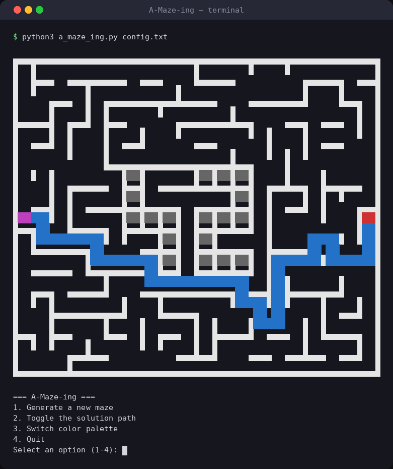

# A-Maze-ing

[](https://www.python.org/)


**A dependency-free maze generator and terminal viewer in Python.** Recursive-backtracking
generation, optional loops, BFS shortest path, ANSI-color rendering and a clean export format — with
the core packaged as a standalone, pip-installable `mazegen` module.



## Highlights

- **Randomized DFS (recursive backtracker)**: perfect mazes where every cell is reachable;
  deterministic output for a given `SEED`.
- **Non-perfect mode**: removes a controlled ratio of walls while rejecting any move that would
  create a 3×3 open area — corridors stay at most two cells wide.
- **BFS shortest path** between entry and exit, exported as `N/E/S/W` directions plus coordinates.
- **Logo pattern**: a centered "42" is carved into the maze and protected during generation and loop
  insertion; configurations that would collide with the entry/exit are rejected with a clear error.
- **Interactive terminal UI**: colored rendering, toggle the solution path, two color palettes,
  regenerate without restarting.
- **Reusable packaging**: `mazegen.py` is a single self-contained, stdlib-only file, built as a
  wheel + sdist with `make package`.

## Quick start

Runtime: Python 3.10+, standard library only. Development tooling uses
[uv](https://docs.astral.sh/uv/).

```bash
git clone https://github.com/imyassmine/a-maze-ing.git && cd a-maze-ing
python3 a_maze_ing.py config.txt    # zero-dependency run
# or via the Makefile:
make install && make run
```

Menu: generate a new maze, toggle the solution path, switch palette, quit.

## Use it as a library

```python
from mazegen import MazeGenerator

maze = MazeGenerator(width=20, height=15, seed=42).generate()
print(maze.solution_directions)  # ['South', 'South', ...]
print(maze.solution_path)        # [(0, 0), (0, 1), ...]
```

## Configuration

`config.txt` is a plain `KEY=VALUE` file (`#` comments supported):

```text
WIDTH=20
HEIGHT=15
ENTRY=0,7
EXIT=19,7
OUTPUT_FILE=output_maze.txt
PERFECT=False
```

| Key | Description |
| --- | --- |
| `WIDTH`, `HEIGHT` | Maze size in cells |
| `ENTRY`, `EXIT` | `x,y` coordinates |
| `OUTPUT_FILE` | Exported maze file |
| `PERFECT` | `True` = spanning tree, `False` = add loops |
| `SEED` | Reproducible generation (random 8-bit seed if omitted) |

Output format: one hexadecimal row per line, a blank line, entry, exit, then the path as `N/E/S/W`.

## Architecture

```
a_maze_ing.py       CLI entry point
mazegen.py          standalone MazeGenerator: generation, BFS, export
src/config/         KEY=VALUE parser and validation
src/ui/display.py   ANSI rendering + interactive menu
src/patterns/       42 logo pattern
```

**Stack:** Python 3.10 · standard library only · uv · mypy · flake8

---
*Built at [42 Paris](https://42.fr) by [Yassmine Abdallah (@imyassmine)](https://github.com/imyassmine)
and mdjigo.*
